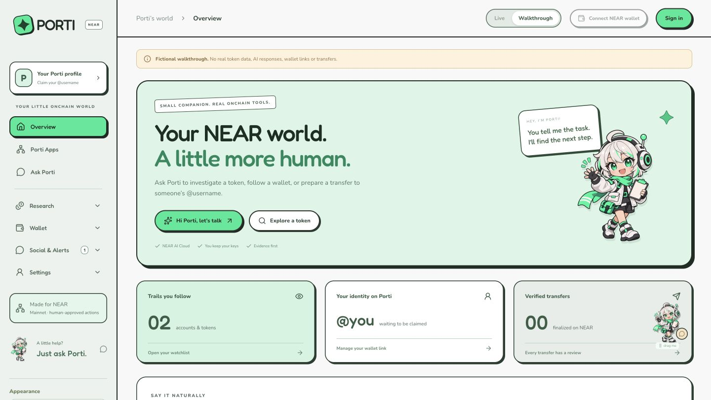

# Porti — your NEAR companion

Research a token, follow a wallet, and prepare a payment, swap or stake in one place. Porti brings a movable anime companion, NEAR AI Cloud and onchain tools into a shared workspace. **The AI prepares actions; you review and approve them in your wallet.** Porti Pocket adds a separate, contract-capped USSD payment path for feature phones.

**Hackathon beta · v0.14 · documentation reviewed 13 November 2026.** This repository contains implemented workflows and automated checks, alongside integrations that need provider setup or live acceptance. It is not a claim that every feature is production-ready.

[Open Porti](https://porti-near.hoymick240.workers.dev/) · [65-second demo video](docs/demo/Porti-Demo.mp4) · [Judge guide](HACKATHON.md) · [Setup](docs/setup.md) · [Verification evidence](docs/verification-2026-11-13.md)



## Why Porti

- **Research where you act:** inspect charts and risk evidence, then open a wallet workflow inside the same chat.
- **Connect once:** landing-page wallet sign-in restores the matching provider and main-wallet role across features. A disconnected or locked signer still needs recovery at approval time; each transaction still needs its normal approval.
- **Readable evidence:** source links, timestamps, exact units, missing checks and pending outcomes stay visible.
- **Return to your workspace:** saved watches, observations, app pins, conversation history and receipts give ongoing context. Telegram delivery is a separately configured capability.
- **Include feature phones:** Porti Pocket uses onchain limits and PIN-confirmed USSD flows. Its public simulator is separated from real-phone mainnet payments.

Porti is an independent application on NEAR, not a new blockchain or an official partner of the services listed below.

## Try it without funds

1. Open Porti and choose **Try demo**. The ordinary workspace walkthrough uses labelled fictional data; AI inference and ordinary wallet approvals are paused there.
2. On Overview, open the **MOCHI** sample report under **What you're looking into**. Inspect the chart and **Risk checks**; unknown checks stay unknown.
3. Open the companion and choose **Stake NEAR** from **Explore Porti** to see an embedded workflow. Demo mode does not prepare a real stake.
4. Explore **Porti Apps**, **Markets**, **Friends** and **Phone pocket**. The Phone Pocket simulator is a separate testnet integration, not a fictional mainnet balance.

[Five screenshots and the timed demo script](docs/demo/README.md) show the public fixture walkthrough. The captioned video is silent and does not demonstrate a settled payment.

**Phone Pocket on current `main`:** `+999` simulator numbers use a shared NEAR **testnet** pocket when the owner has configured it. Try Balance; sending to demo recipient `bob` uses the public demo PIN `1234`. The demo pocket has shared balance/caps, so availability depends on configuration, testnet RPC and remaining allowance. The real-phone route uses **mainnet** and separate keys. See [Pocket setup and limits](docs/ussd-pocket.md). No real carrier or funded mainnet acceptance is implied by the simulator.

## Features and their boundaries

| Area | What is implemented | What to know |
| --- | --- | --- |
| Wallet sign-in | NEP-413 proof, account/domain/nonce binding, seven-day server session, shared account restoration | Sign-in proves control, costs no gas and grants no spending permission. Main and optional agent roles remain distinct. |
| Ask Porti / mini companion | Text/tool chat, movable avatar, stop/cancel, **Clear chat**, picture input and 19 embedded workflows | Needs a valid NEAR AI Cloud key for inference; image input also needs R2. Clear chat preserves saved wallets, reviews and receipts. No provider or model silently replaces the chosen one. |
| Token research / Rug Guard | NEP-141 metadata, sampled holder candidates, concentration evidence, account-key checks, WASM export screening and selected control getters | Partial screening, not an audit or rug probability. LP locks, sellability, taxes and hidden ownership can remain unknown. Bubble map and Top Traders are not current UI features. |
| Charts / markets | Pool-based price and volume, completed candles, EMA20/50, RSI14, prior support/resistance, positive 24h gainers and a curated memecoin watchlist | Limited provider/pool coverage. Fetch time is distinguished from quote time; stale snapshots are labelled. No profit ranking or price prediction. |
| Tracking / watchlist / alerts | Saved token/wallet watches, observations and categorized alert events | Indexer/RPC availability limits coverage. An incoming transfer is not necessarily a buy; unattended delivery needs an authorized runner. |
| Device agent wallet | Local Ed25519 implicit address, encrypted IndexedDB vault, password unlock, encrypted backup/restore, funding controls and private-key export | No paid wallet API required. Keys stay in the browser. First native NEAR transfer creates the onchain account; sender pays network costs. No seed phrase is generated. Browser wallet security is not hardware isolation. |
| Transfers / username payments | Native NEAR and NEP-141 token reviews, exact amounts/recipients, verified `@username` resolution, main↔agent transfers, receipt reconciliation | Wallet signature required. Role and signer changes invalidate inappropriate reviews; pending outcomes must be reconciled, never automatically resent. USD-sized transfers are capped at $100; native transfers at 100 NEAR per request. |
| Swap / cross-chain delivery | NEAR Intents / 1Click catalog, quotes, registration checks, native NEAR wrapping/funding, expiry, destination/refund binding and settlement lookup | Source/refund wallet stays on NEAR. Same-chain and supported Ethereum/Base/Arbitrum/BNB Chain outputs depend on live routes. Not arbitrary source-chain execution. |
| Stake NEAR | Meta Pool review from chat or form; 1–100 NEAR; matching stNEAR mint evidence required for success | Uses fixed `meta-pool.near`. Built-in unstaking/exits are absent; use Meta Pool separately. No promised yield. |
| Buy NEAR | Chat purchase intent and reviewed MoonPay checkout preparation | Owner merchant configuration required. Card/Apple Pay depend on provider, device, geography and eligibility. Checkout opening/return is not payment confirmation; no purchase-confirmation webhook is implemented. |
| Porti Apps | Search, categories, saved pins and five allowlisted read-only adapters | Rhea Pool Lens, NEAR Staking Lens, Meta Pool, NEAR Social and AstroDAO. Not unrestricted embedded third-party execution. |
| Profile / X | Verified username-to-wallet link and OAuth account-linking flow | Wallet/X control is not real-world identity verification. X linking requests no posting or DM permissions; owner OAuth setup required. |
| Friends / private groups | Friend requests, accept/decline/cancel, blocking, direct messages, explicit group invitations, membership controls and picture permissions | Private access is checked on reads/writes. Polling is every 10 seconds while visible. Messages/pictures are server-stored, not end-to-end encrypted. R2 required for pictures. |
| Telegram | Dedicated encrypted bot settings, private Start-code pairing, category preferences, queueing, pause/resume/test and acknowledgement tracking | The public standalone Worker disables the shared maintenance endpoint. The legacy owner-private Site updater is separate; its success does not establish current Worker delivery. |
| Porti Care | Evidence-backed support requests, immutable token/recipient, two independent human approvals, direct donation reviews and receipt-based totals | Requires R2 and two configured reviewer identities. No automated authenticity guarantee, escrow or tax-deductibility claim. |
| Phone Pocket | Rust contract caps, Balance, PIN-confirmed Send to username, Last 3 sends, Freeze; separate public testnet simulator | Server holds a scoped pocket key for `send`/`freeze`, separate from AI and normal wallets. Live phone provisioning/carrier acceptance, SMS receipts and later pending reconciliation remain incomplete. |
| Appearance / status | Auto, Light and Dark themes; grouped navigation; database/RPC and provider setup/evidence views | Auto follows local device time: light 07:00–18:59, dark 19:00–06:59. Some health-screen version/private-deployment labels lag the current public beta. |

**Outside current scope:** leveraged long/short trading, perps, lending, vault strategies, built-in unstaking, complete holder/trader coverage, guaranteed fraud detection and autonomous main-wallet spending.

## How a wallet action works

1. The user supplies a typed request or fills a workflow. Images and external metadata cannot authorize a payment.
2. Porti resolves an exact account/token and prepares a bounded review with the sender, amount, destination, fees/reserve and expiry. Known native-transfer, swap and staking paths can prepare reviews without waiting for general AI inference.
3. Approval checks the saved review, current wallet role and actual matching signer. A plain “yes” only acts on an eligible displayed review; it never establishes completion.
4. The wallet shows its own signing approval. Porti stores the original transaction hash and checks execution evidence.
5. Success requires matching receipts/settlement evidence. A popup, model reply, hash or ambiguous timeout alone is not success.

The Pocket path is different: the USSD user confirms with a PIN and the server uses a restricted function-call key. The contract limits spending; the normal main/agent wallet keys are not given to the server or AI. [Transaction boundaries](docs/transactions.md) · [Device wallet](docs/internal-wallet.md) · [Pocket](docs/ussd-pocket.md).

## Stack and external services

| Service / dependency | Use in Porti | Configuration / limits |
| --- | --- | --- |
| NEAR AI Cloud | OpenAI-compatible chat completions and tool/vision requests at `https://cloud-api.near.ai/v1/chat/completions` | Per-user encrypted Connections key or optional shared `NEAR_AI_API_KEY`. Default model in source: `zai-org/GLM-5.1-FP8`; availability is provider-dependent. |
| NEAR JSON-RPC | Finalized account, key, contract and receipt reads; user-approved transaction broadcast | Mainnet default `https://rpc.mainnet.near.org`; bounded investigation fallback to FastNEAR. Simulator has separate testnet RPC. |
| NearBlocks v3 | Holder/transfer indexer candidates and explorer evidence | Optional `NEARBLOCKS_API_KEY`; rate limits/access restrictions can leave incomplete data. |
| GeckoTerminal v2 | NEAR pool market snapshots and OHLCV charts | Limited single-pool coverage; cannot stand in for an executable quote. |
| DefiLlama Coins | USD reference-price lookup | Reference valuation, not a trade quote. Research-only Rhea pool fallback is separate. |
| NEAR Intents / 1Click | Token catalog, swap quotes, deposit and settlement status | `https://1click.chaindefuser.com/v0`; optional `NEAR_INTENTS_API_KEY`. |
| Meta Pool / Rhea / SocialDB / Sputnik DAO | Allowlisted direct contract reads; Meta Pool staking execution path | Exact contracts/methods in [Porti Apps guide](docs/porti-apps.md). |
| NEAR Connector / near-api-js | External wallet connection, NEP-413 signing, serialization and RPC integration | Wallet support varies; unsupported OKX native-transfer path is blocked explicitly. |
| Seams | Optional managed/passkey wallet integration | Requires separate compatible infrastructure/sponsor; not required for the free device wallet. |
| MoonPay / X OAuth 2 / Telegram Bot API | Onramp checkout, X account linking, linked alert delivery | Each needs its own configuration and acceptance. |
| Africa’s Talking-compatible USSD | Real-phone callback format | Live callback token, carrier provisioning, linked phones and restricted pocket key required. |
| React 19 / TypeScript / vinext / Vite / Tailwind 4 | Workspace UI and Next-style server routes | Versions are pinned/resolved in `package-lock.json`. |
| Cloudflare Workers / D1 / optional private R2 / Drizzle | Runtime, durable state, attachments and ordered migrations | Source backups do not back up production data, vaults or secrets. |

**AI credits:** the build used the NEAR Builders program linked at [nearbuilders.org/build](https://nearbuilders.org/build) for the earlier $10 promotional API allocation. That is historical project context, not a promise of an available offer or verified remaining balance. The current page links to the NEAR AI Cloud dashboard; eligibility, redemption, key and balance depend on the issuer. Enter the issued compatible key only through **Connections**. Porti does not manufacture credits or include a key in this repository.

## Run locally

Use **Node.js 22.22.2+** (CI uses Node 22) and locked dependencies.

```sh
git clone https://github.com/hoymick/porti-near.git
cd porti-near
git checkout main
npm ci
npm run db:local -- migrate
npm run dev
```

Open the URL printed by dev (portable default: `http://localhost:5173`). The public fixture walkthrough needs no paid key. Live AI needs a valid key in Connections; encrypted settings need a stable `PORTI_SETTINGS_KEY` in local `.dev.vars`. Generate and enter it privately; never commit or paste secret values into chat.

### Verify the source

```sh
npm run check
npm test
npm run lint
npm audit --audit-level=high
npm run build

# Build-only placeholder. NEVER deploy this database ID.
PORTI_D1_DATABASE_ID=11111111-1111-4111-8111-111111111111 npm run build:cloudflare
```

Current review baseline: [`b297504`](https://github.com/hoymick/porti-near/tree/b2975045dc97e7877fda5e38abcaafbb84b9aa7e). **264 app tests passed**, with no failures/skips. Typecheck/lint/build outcomes and their limitations are recorded in [dated verification](docs/verification-2026-11-13.md). The earlier contract CI passed **25 tests**; app mocks and a sandbox do not establish live mainnet settlement or an independent security audit.

Optional contract validation uses the pinned Rust toolchain:

```sh
cd contracts/pocket
cargo fmt --check
cargo clippy --all-targets --locked -- -D warnings
cargo test --locked
```

For a private local chain, follow [Pocket sandbox instructions](docs/ussd-pocket.md#local-testing-no-mainnet-no-near-spent). `npm run pocket:testnet` provisions real **testnet** accounts/contract using free test NEAR; run it deliberately after reading that guide. It is not part of ordinary verification and was not executed in this documentation review.

## Configuration and deployment

The current public app is the standalone Cloudflare Worker. `main` is the default source branch; the configured Worker build branch is `cloudflare-standalone`. New source on `main` is not automatically evidence that the Worker has deployed it. Check the exact production build commit before demos. The original owner-private Sites app is a separate deployment with separate data and authorization; preserve its privacy.

| Layer | Required values / bindings |
| --- | --- |
| Standalone build | `PORTI_D1_DATABASE_ID` for the **existing** real D1 database; `NODE_VERSION=22.22.2` or later. Optional `PORTI_R2_BUCKET` adds private `BUCKET`. |
| App runtime | D1 `DB`, stable secret `PORTI_SETTINGS_KEY`, actual HTTPS `PORTI_APP_URL`; wallet-session mode is default on standalone/local. |
| Optional providers | AI/indexer/RPC, Intents, MoonPay, X, reviewer identities and USSD settings, documented in [setup](docs/setup.md). |

The generated Worker config disables preview URLs. `npm run deploy:cloudflare` applies **remote D1 migrations then deploys**; it is an intentional production mutation, not a test command. Preserve existing resource IDs, secrets and migration history. The [Cloudflare runbook](docs/cloudflare-hosting.md) covers public wallet-session mode, optional Access mode, R2 and the disabled standalone Telegram runner.

## Known gaps before broader use

The earlier 13 November hosted inspection found missing R2, MoonPay, X, optional Seams and Care reviewer setup; the standalone maintenance endpoint was disabled. This review checks source/tests and public HTTP access, not secret values or signed-in provider configuration. Those earlier observations are dated, not a fresh configuration inventory.

Live two-user social acceptance, actual carrier delivery, mobile-device acceptance, owner-approved funded transfer/swap/stake/purchase/donation, a production data-restore drill and independent security review remain separate checks. SMS inbox/later Pocket reconciliation and built-in exit workflows remain unfinished. Do not advertise every feature as fully operational based only on passing tests.

## Source map and documentation

| Path | Responsibility |
| --- | --- |
| `app/near-workspace.tsx`, `app/porti-companion.tsx` | Shared workspace, navigation, mini chat and inline approval UI |
| `lib/near-agent.ts`, `lib/near-ai.mjs` | Bounded tools, explicit instructions, timeout/retry policy |
| `lib/near-session.mjs`, `lib/near-profile.ts`, `lib/review-wallet.mjs` | Sign-in, usernames, roles and matching signer recovery |
| `lib/near-services.ts`, `lib/staking.ts`, `lib/swaps.ts` | Research, reviews and receipt/settlement evidence |
| `lib/friends.ts`, `lib/groups.ts`, `lib/media.ts`, `lib/charity.ts` | Membership, private attachments and donation controls |
| `lib/ussd*.mjs`, `lib/ussd.ts`, `contracts/pocket/` | USSD state machine, channel separation and capped contract |
| `worker/`, `drizzle/`, `scripts/`, `.github/workflows/` | Runtime, migrations, local/build/deploy tooling and CI |
| `sdk/porti-apps.ts`, `lib/porti-app-registry.ts` | Reviewed application manifests and read-only adapters |

[Sign-in](docs/sign-in.md) · [AI reliability](docs/near-ai-reliability.md) · [Social](docs/social-chat.md) · [Care](docs/porti-care.md) · [Staking](docs/staking.md) · [Operations](docs/operations.md) · [Submission checklist](docs/hackathon-submission.md)

Historical release notes are dated snapshots. Use this README, current setup guides and the dated verification record for current scope. Open an issue with steps, a sanitized error code/request ID, source commit and expected/actual behavior. Never include keys, vault backups, proofs, cookies or private user data.

## Provenance and licensing

Repository history begins 4 November 2026 and includes imported/source checkpoints. An import date does not prove every imported line was written during the hackathon; disclose any earlier foundation in the entry. This project began as a broader agent concept and now targets NEAR; old hosting identifiers do not change the Porti brand.

Fredoka/Nunito licenses are retained under `public/fonts`. A project-wide source license has not been selected. Public visibility alone is not a new licensing grant. Contributions should preserve exact reviews, account isolation, secret handling, honest unknowns and separate testnet/mainnet boundaries.
