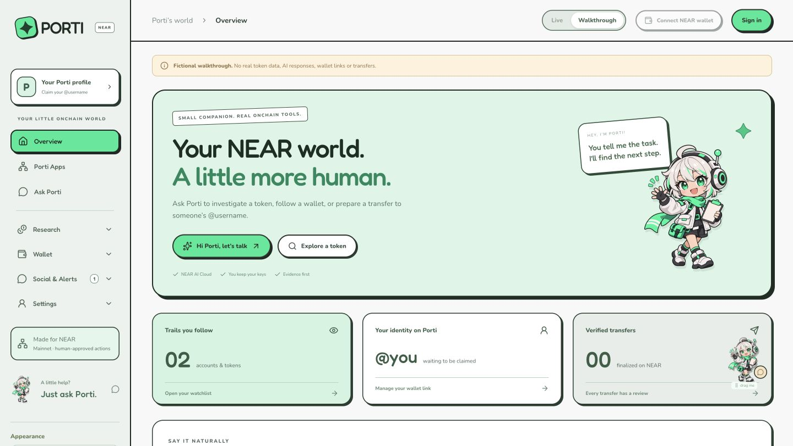
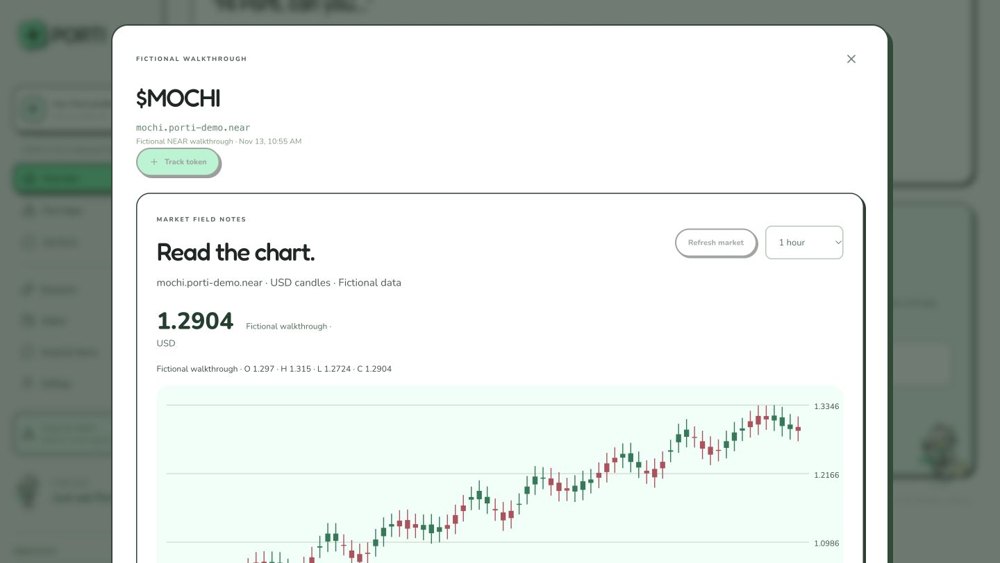
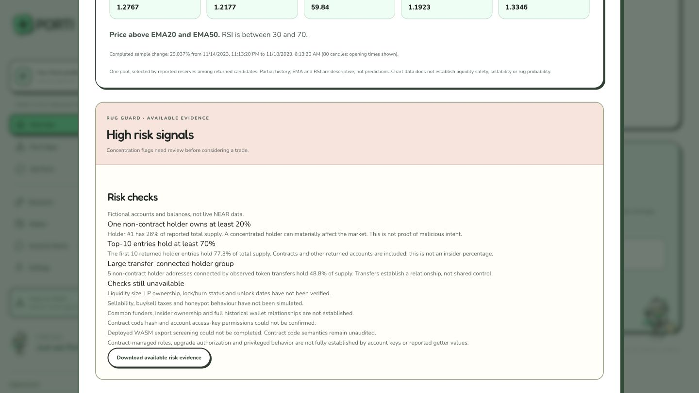
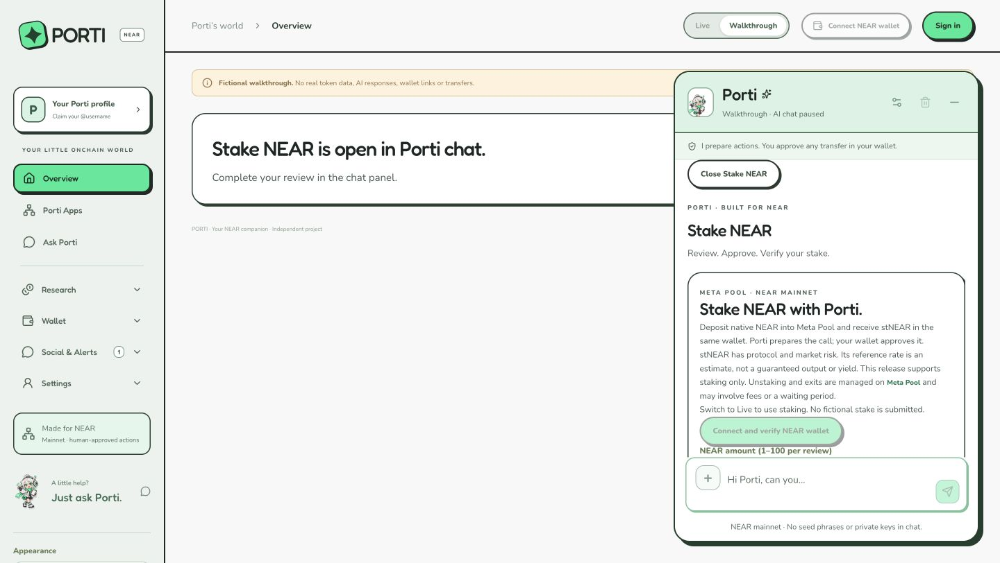
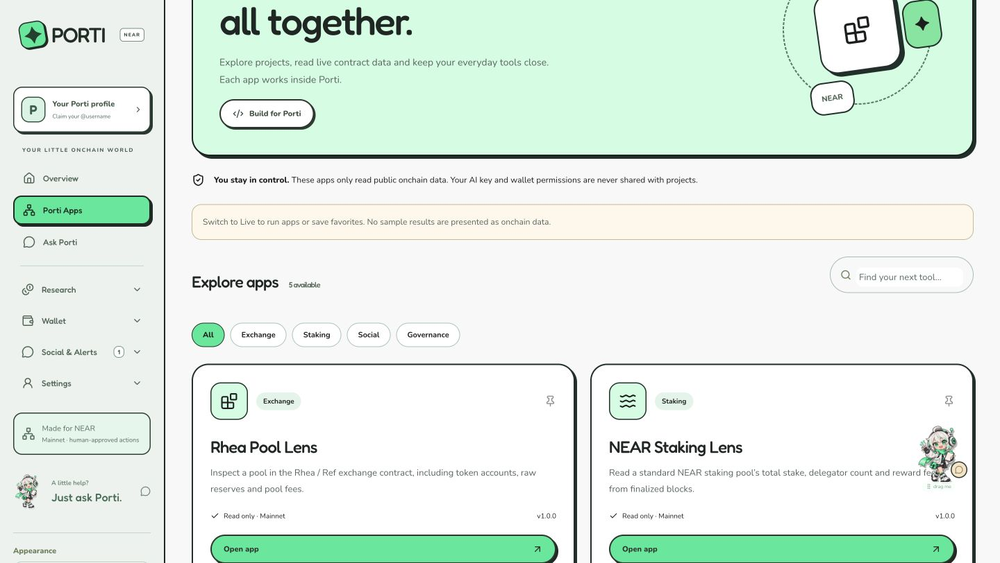

# Porti submission demo

Captured from the public deployment on **13 November 2026**, application baseline `80ca0eb`. These are actual browser screenshots. Fictional token data and paused AI are deliberately labelled. No transaction, payment, wallet export or message to another person was performed.

**[Open the hosted demo](https://porti-near.hoymick240.workers.dev/)** → **Try demo**. No sign-in, email code, API key or funds needed for this sequence.

**[Download the 65-second captioned MP4](Porti-Demo.mp4)** — 1080p, silent, approximately 1.1 MB. Captions carry the explanation; no voiceover or music is required.

## 65-second captioned demo script

| Time | On screen | Caption / narration |
| --- | --- | --- |
| 0–10s | Overview | Meet Porti: a friendly place to research NEAR and prepare reviewed actions. This is the public fictional walkthrough. |
| 10–21s | Select MOCHI sample report | Open a token report to inspect the chart and descriptive indicators. The report labels its source and sample data. |
| 21–33s | Scroll to Risk checks | Review concentration signals alongside missing checks. Unknown evidence stays unknown; this is not a safety verdict. |
| 33–45s | Close report → open companion → Explore Porti → Stake NEAR | Workflows stay inside chat. Live reviews still need user wallet approval; walkthrough mode cannot submit a stake. |
| 45–55s | Minimize chat → Porti Apps → Explore apps | Five curated read-only adapters bring NEAR contract tools into one interface. This screen shows adapter descriptions, not executed live calls. |
| 55–65s | Verification end card | 245 app tests and 25 contract tests passed. Tests include mocks. Live provider access and funded settlement are separate acceptance steps. |

The accompanying MP4 is a **captioned screenshot walkthrough**, not continuous screen capture or a recording of a live AI/financial transaction. The five original images below are also suitable for a screenshot-based demo post, with the hosted URL. Do not crop out fictional-data warnings or describe fixtures as mainnet evidence.

## 1. Public overview

The user can enter without a login. Live private workspaces require NEAR-wallet sign-in.

## 2. Sample token chart

Select the MOCHI report under “What you're looking into.” Prices and candles here are fictional.

## 3. Evidence and unresolved checks

Scroll to Risk checks. Concentration signals do not prove malicious intent. Liquidity locks, sellability and contract semantics remain explicitly unresolved.

## 4. Workflow inside chat

Close the report, open the floating companion, select Stake NEAR from Explore Porti. It shows Meta Pool's staking form inside chat, with live preparation disabled in walkthrough mode. This is not a completed stake or approval card.

## 5. Curated NEAR apps

Minimize chat and open Porti Apps. Five adapter definitions are available: Rhea Pool Lens, NEAR Staking Lens, Meta Pool, NEAR Social and AstroDAO. Live execution is separate from viewing this directory.

## Suggested X post — owner publishes

Attach the captioned video or screenshots, retain the hosted URL, and check the final wording before posting:

> I built Porti at NEAR HACKATHON: a friendly NEAR companion for token research and wallet-reviewed actions. This demo uses labelled sample data.
>
> https://porti-near.hoymick240.workers.dev/
>
> https://github.com/hoymick/porti-near
>
> @NEARProtocol #NEARHackathon

No X post has been published by this preparation. Paste the **actual public post URL** into the submission; a screenshot, draft or private file link is not that URL. Review [the submission checklist](../hackathon-submission.md) and [verification limits](../verification-2026-11-13.md) before making stronger claims.
